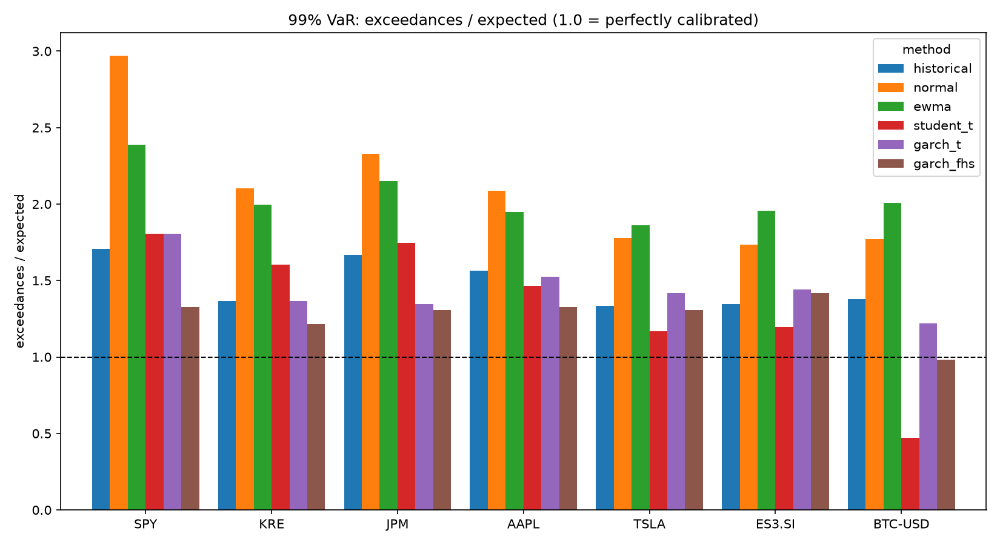
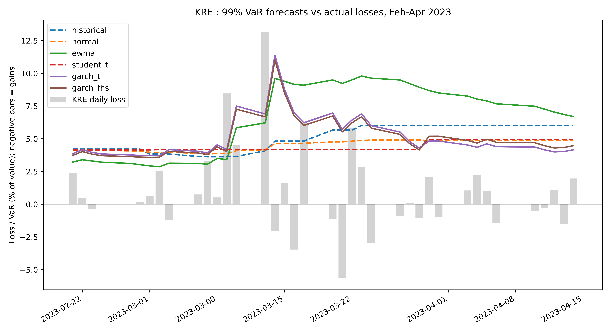

# VaR and Expected Shortfall Backtesting Framework

A from-scratch Python framework that forecasts one-day-ahead Value-at-Risk (VaR) and Expected Shortfall (ES) with six methods, then backtests every forecast with formal statistical tests. It is run on seven assets over roughly 20 years, at 95% and 99% confidence.

**Headline finding:** at 99%, no method passes every test on every asset. Normal and EWMA are clearly unsafe in the tails. A GARCH model with filtered historical simulation (FHS) is the best calibrated, and a March 2023 regional-bank case study shows why adaptive volatility models matter.

Author: Sarunphat Soontornwipat

---

## Data

Daily closing prices (downloaded with `yfinance`) for seven assets, 2005 to October 2026:

| Asset | What it is | Why it is included |
|---|---|---|
| SPY | S&P 500 ETF | Well-behaved baseline |
| KRE | Regional bank ETF | March 2023 stress case |
| JPM, AAPL | Large-cap stocks | Single-name behaviour |
| TSLA | High-volatility stock | Heavier tails |
| ES3.SI | Singapore STI ETF | Non-US asset (see limitations: stale prices) |
| BTC-USD | Bitcoin | Extreme fat tails |

Prices come from Yahoo Finance and are included for reproducibility, for personal and educational use. The last row of the file is dropped because it is probably an unfinished trading day. Forecasts are made on log returns.

## Methods

All forecasts are **one day ahead and use only information available before that day** (no look-ahead).

| Method | How it works |
|---|---|
| `historical` | Empirical quantile of the previous 250 returns; ES is the average of returns beyond it |
| `normal` | Rolling 250-day mean and standard deviation, normal quantile |
| `ewma` | RiskMetrics exponentially weighted variance (lambda = 0.94), normal quantile |
| `student_t` | Student-t fitted to the previous 500 returns, refit every 20 days |
| `garch_t` | GARCH(1,1) with Student-t innovations on a 500-day window, refit every 20 days; variance updated daily in between |
| `garch_fhs` | Same GARCH model, but VaR and ES come from the empirical distribution of its standardized residuals (filtered historical simulation) |

## Backtests

| Test | What it checks |
|---|---|
| Kupiec POF | Is the exceedance rate equal to the target (1% or 5%)? |
| Christoffersen independence | Do exceedances cluster (several in a row)? |
| Conditional coverage | Both of the above together |
| ES ratio | On exceedance days, realised loss divided by forecast ES (should average about 1) |
| FZ0 score | Single score for VaR and ES jointly (Patton, Ziegel and Chen, 2019); lower is better |
| Basel traffic light | Green / yellow / red from exceedances over the last 250 days (99% only, in `results.csv`) |

For each asset and confidence level, all six methods are trimmed to the same start date, so no method is scored on an easier sample.

## Results



99% VaR exceedances (a perfectly calibrated model matches the "expected" column; bold = closest to expected):

| Asset | Expected | Normal | EWMA | Historical | Student-t | GARCH-t | GARCH-FHS |
|---|---|---|---|---|---|---|---|
| SPY | 50 | 148 | 119 | 85 | 90 | 90 | **66** |
| KRE | 46 | 97 | 92 | 63 | 74 | 63 | **56** |
| JPM | 50 | 116 | 107 | 83 | 87 | 67 | **65** |
| AAPL | 50 | 104 | 97 | 78 | 73 | 76 | **66** |
| TSLA | 36 | 64 | 67 | 48 | **42** | 51 | 47 |
| ES3.SI | 41 | 71 | 80 | 55 | **49** | 59 | 58 |
| BTC-USD | 25 | 45 | 51 | 35 | 12 | 31 | **25** |

**Findings**

1. **Normal and EWMA fail at 99% on every asset.** Their Kupiec p-values are effectively zero on all seven, and their ES ratios are 1.20 to 1.33: when they are breached, the actual loss is 20% to 33% larger than they forecast.
2. **GARCH-FHS is the best calibrated.** At 95% it passes the Kupiec test on all seven assets and conditional coverage on six of seven (JPM is the exception). At 99% it is closest to the expected exceedance count on five of seven assets (SPY, KRE, JPM, AAPL, BTC-USD) and passes Kupiec on KRE, TSLA and BTC-USD; Student-t is closer on TSLA and ES3.SI.
3. **No method passes everything at 99%.** Even GARCH-FHS fails conditional coverage on SPY, JPM and ES3.SI, because some of its exceedances still arrive in short runs (for SPY, 9 of its 66 came within five trading days of the previous one). They are spread across many years, not concentrated in 2008 and 2020.
4. **"Best" depends on the criterion.** GARCH-FHS has the best hit counts, but on the joint FZ0 score GARCH-t is slightly better at 99% on five of seven assets (JPM, AAPL, TSLA, ES3.SI, BTC-USD). The margins are small.
5. **Historical simulation clusters.** On SPY, KRE and JPM its exceedances fail the independence test almost completely: the 250-day window reacts too slowly to volatility spikes.
6. **Student-t can be too conservative.** On BTC-USD at 99% it had 12 exceedances against about 25 expected, and an ES ratio of 0.87, so it overstates tail risk. On equities at 95% it is breached too often.

## Case study: regional banks, March 2023



KRE fell roughly 26% in five trading days (6 to 13 March 2023). Over the ten trading days from 6 to 17 March:

- **The first shock beat every model.** On 9 March KRE fell 8.46% and all six 99% VaR forecasts (4.17% or lower) were breached. A one-day-ahead VaR can only react after a shock has happened.
- **The adaptive models reacted within a day.** The next day, EWMA, GARCH-t and GARCH-FHS raised their VaR by about 70% to 80% (to 5.8%, 7.5% and 7.3%) and were not breached by the further 4.49% loss. Historical, normal and Student-t barely moved and were breached again.
- **The 13.14% fall on 13 March beat all six**; the highest VaR that day was 6.89%. This is a case for reading ES alongside VaR.
- **Breaches over the ten days:** GARCH-t 2, EWMA 3, GARCH-FHS 3, historical 4, normal 4, Student-t 4. At 99% a perfect model would be breached about 0.1 times in ten days, and the breaches arrived in a run (9, 10 and 13 March).
- **Student-t was blind to the whole episode.** Its VaR was exactly 4.17% on all ten days because it refits only every 20 days and no refit fell inside the window. This is a consequence of my refit-step design choice, not of the t distribution itself.
- **EWMA overreacted.** Its VaR stayed at 9% to 10% for weeks after the crisis while daily losses were back to normal, so it is safe but costly.

This is ten days on one asset: it illustrates the pattern, while the seven-asset results above are the evidence.

## Limitations

- **Multiple testing.** 7 assets x 6 methods x 2 levels x 3 tests means some p-values below 0.05 will occur by chance. Read the patterns across assets, not any single p-value.
- **Low power at 99%.** A correct model has only about 25 to 50 expected exceedances per asset, so the tests cannot separate close calls.
- **ES backtest is simple.** The ES ratio with a t-test is a quick diagnostic with low power on few exceedances; it is not the formal Acerbi-Szekely test.
- **Data quirks.** ES3.SI has stale and missing prices (many zero-return days), and returns across its gaps span several days. BTC-USD is on the US trading-day calendar, so its Monday returns cover three days.
- **Scope.** One-day horizon, single assets (no portfolio), no parameter tuning (lambda = 0.94, windows of 250 and 500, refit every 20 days).

## Possible extensions

- Portfolio-level VaR and ES with a copula or DCC-GARCH
- 10-day horizon (the Basel standard)
- Refit more often for Student-t (for example every 5 days) and compare
- Formal ES backtest (Acerbi-Szekely) and a multiple-testing correction

## How to run

Requires Python 3.12 or newer.

```
pip install -r requirements.txt
python run.py      # all assets and methods; writes results.csv and forecast.pkl (about 3 minutes)
python charts.py   # writes kre_march2023.png and calibration_99.png
python stress.py   # prints the March 2023 KRE breach tables
```

## Files

| File | Purpose |
|---|---|
| `models.py` | The six VaR / ES methods |
| `backtest.py` | Kupiec, Christoffersen, conditional coverage, ES ratio, FZ0, Basel traffic light |
| `run.py` | Runs everything and saves `results.csv` and `forecast.pkl` (the pickle is regenerated by `run.py` and not committed) |
| `stress.py` | March 2023 KRE case study tables |
| `charts.py` | The two figures above |
| `portfolio_risk_dataset.csv` | Input prices |
| `results.csv` | Full backtest results for every asset, level and method |
